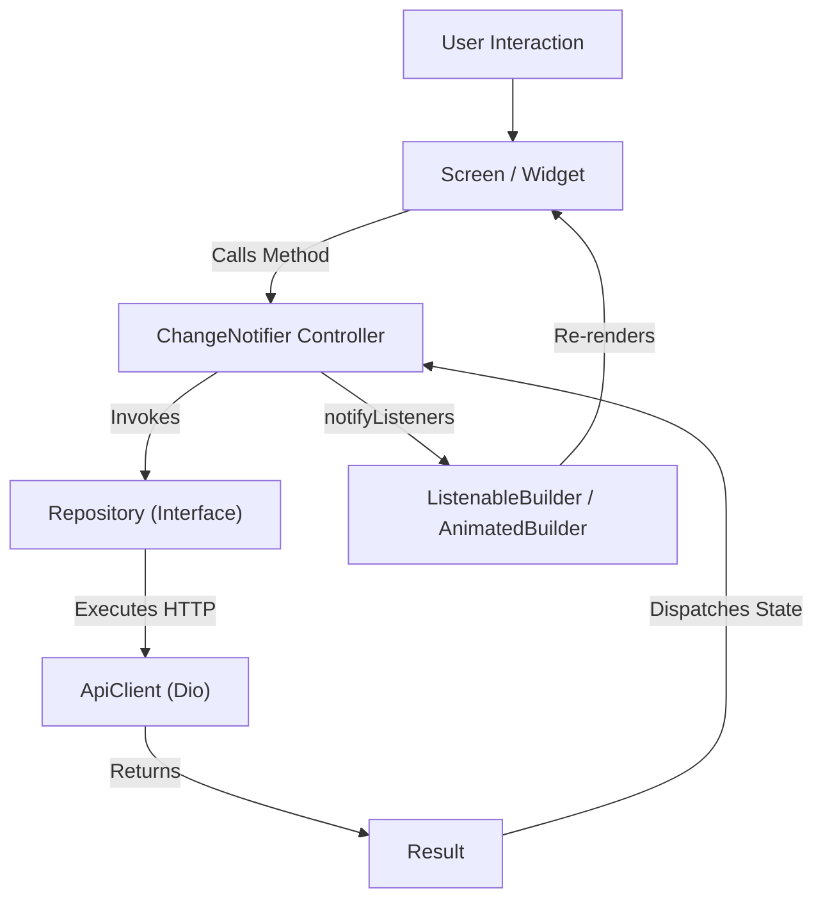
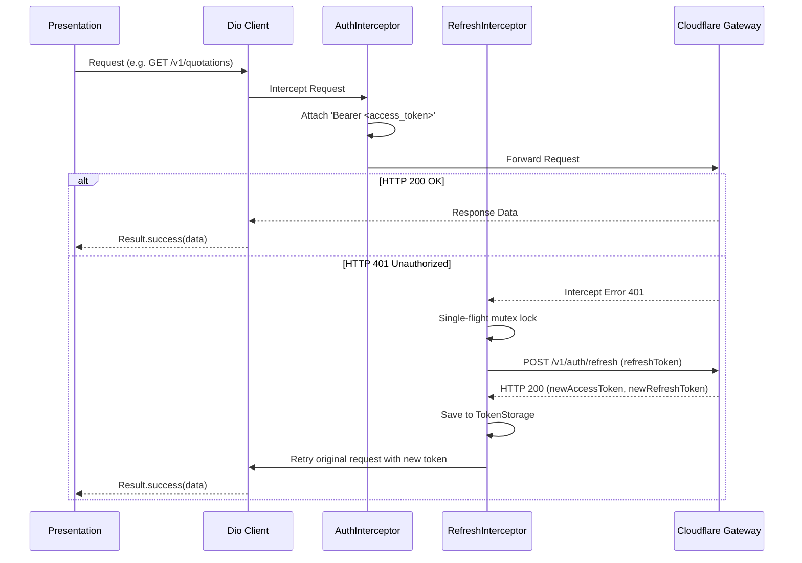

# Sunvine EPC Architecture & Engineering Blueprint

This document specifies the technical architecture, design patterns, state management, and API contracts for the Sunvine EPC monorepo.

---

## 1. Architectural Principles

### 1.1 Clean Architecture (Feature-First)
The Flutter application follows a Feature-First Clean Architecture structure:
```
feature/
├── data/              # Concrete implementations, API calls, data sources, DTOs
├── domain/            # Entities, abstract repository interfaces, domain services
└── presentation/      # UI screens, reactive controllers, reusable subwidgets
```

**Dependency Rule**: Outer layers depend on inner layers. The `domain` layer has no dependencies on Flutter widgets or network libraries (`dio`). The `presentation` layer interacts with data only through `controllers` and repository interfaces.

### 1.2 Separation of UI and Business Logic
- **UI Components** (`screens/`, `widgets/`): Pure renderers. They do not initiate direct HTTP calls, do not parse raw JSON, and do not execute business rules.
- **Controllers** (`controllers/`): Extend `ChangeNotifier`. They hold observable UI state, orchestrate repository calls, handle exceptions, and notify listeners.
- **Dependency Injection**: Managed by `ServiceLocator`. Components never instantiate dependencies directly with hardcoded parameters.

---

## 2. State Management Architecture



### Key Controller Lifecycle
1. **Initial**: Status is `initial`. Triggered by screen `initState()` or on demand.
2. **Loading**: Sets `isLoading = true`, clears previous error messages, calls `notifyListeners()`.
3. **Success**: Stores typed entities, sets status to `loaded`, calls `notifyListeners()`.
4. **Failure**: Converts domain `Failure` to user-facing message, sets status to `error`, calls `notifyListeners()`.

---

## 3. Error Handling Architecture

### 3.1 Failure Hierarchy
All operations that can fail return `Result<T>` rather than throwing uncaught exceptions to the UI:
- `NetworkFailure`: Connection timed out or no network connectivity.
- `AuthFailure`: Invalid credentials, expired token, or signature failure (HTTP 401).
- `ForbiddenFailure`: Account suspended or unauthorized tier (HTTP 403).
- `RateLimitFailure`: Rate limit threshold exceeded with `retryAfter` delay (HTTP 429).
- `ServerFailure`: Gateway 5xx internal error.
- `ValidationFailure`: Invalid user input.

### 3.2 UI Resilience
Every listing screen provides:
- **`SunLoadingIndicator`**: Consistent branding spinner while fetching data.
- **`SunErrorView`**: Displays actionable failure explanation and a "Try Again" button.
- **`SunEmptyState`**: Displays helpful guidance and a call-to-action when datasets are empty.

---

## 4. API & Network Architecture

### 4.1 Interceptor Pipeline


### 4.2 Endpoint Registry
| Endpoint | Method | Auth Required | Description |
|---|---|---|---|
| `/` | `GET` | No | Service identification & baseline ping |
| `/v1/health` | `GET` | No | Diagnostic health checks (boolean values only) |
| `/v1/app/version` | `GET` | No | OTA app update verification |
| `/v1/auth/login` | `POST` | No | Dealer authentication via mobile + password |
| `/v1/auth/refresh` | `POST` | No | Single-use refresh token rotation |
| `/v1/auth/logout` | `POST` | No | Revokes refresh token family |
| `/v1/me` | `GET` | Bearer | Dealer profile details and margin cap |
| `/v1/catalog/bootstrap` | `GET` | Bearer | Master catalog, modules, inverters & matrices |
| `/v1/quotations` | `GET` | Bearer | List recent consumer solar quotations |
| `/v1/customer-files` | `GET` | Bearer | Active installation pipeline files |
| `/v1/ledger` | `GET` | Bearer | Financial ledger entries and payout summary |

---

## 5. Security Invariants

1. **Zero Secret Leakage**:
   - `JWT_SECRET` and `SUPABASE_SERVICE_ROLE_KEY` are strictly server-side in Cloudflare Workers.
   - Client APK never contains master keys or service role tokens.
   - `/v1/health` outputs boolean indicators only and never prints raw environment variables.
2. **Encrypted Token Storage**:
   - Stored in Android `EncryptedSharedPreferences` via `FlutterSecureStorage`.
3. **Refresh Token Reuse Detection**:
   - Refresh tokens are strictly single-use. If an already-rotated token is presented, the entire token family is immediately revoked, protecting against replay attacks.
4. **D1 Rate Limiting**:
   - Per-IP and per-account rate limits track failed attempts in Cloudflare D1 with automatic exponential lockouts.
