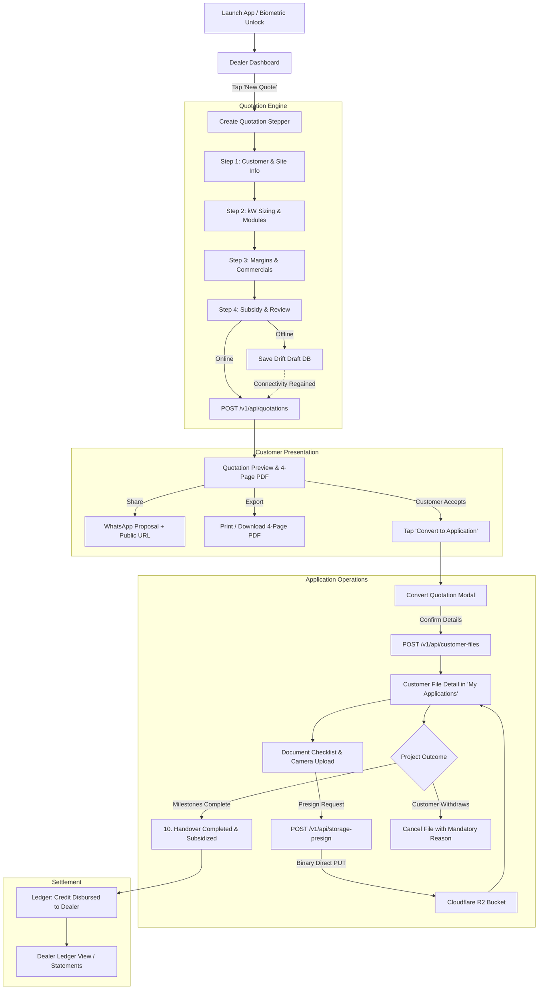

# Sunvine EPC Dealer Mobile — Flow Map & Technical Specification
**Document Version:** 1.0.0 (Phase 0 Step A)  
**Status:** Submitted for Engineering & Product Approval  
**Target Roles:** Authorized Solar EPC Dealer (Gujarat Network)  
**Platform Scope:** Native Android App (Flutter 3.47.x / minSdk 26) + Cloudflare Worker Gateway (`/v1`)  
**Backend Source of Truth:** `https://github.com/sunvinerenewable/Sunvine-CRM` (Vercel Node Serverless + Supabase + Cloudflare R2)  

---

## 1. Executive Summary & Mobile Architecture Principles

This document specifies the end-to-end screen flows, data dependencies, validation logic, and mobile adaptation blueprint for the **Sunvine EPC Dealer Mobile App**.

### 1.1 Architectural Guardrails
1. **Database-First Direct Hydration:** No operational data lives exclusively on the mobile device, except offline quotation drafts. On cold launch and resume, fresh data is fetched via the Cloudflare gateway.
2. **Offline-Tolerant Quotations:** Quotation drafting is supported offline using Drift/SQLite, with local provisional pricing estimates. Final totals and unguessable share tokens are strictly recomputed and confirmed by the server upon sync.
3. **Rotating Session Security:** The mobile client stores a rotating refresh token in `flutter_secure_storage`. The Cloudflare gateway mints short-lived access JWTs (1 hour) matching origin claim structures. Stored plaintext passwords and bearer tokens are never persisted or logged. Biometric unlock protects resumes after 5 minutes in background.
4. **Non-Blocking Operations:** Per Project Rule 7, document uploads are optional at all stages. Customer files and proposals save with zero attachments.
5. **Mobile-Native Ergonomics:** Replaces web desktop sidebars and multi-column tables with an ergonomic bottom navigation bar, swipe actions, modal bottom sheets, camera capture, and native PDF/WhatsApp sharing.

---

## 2. Global Shell & Navigation Blueprint

### 2.1 Navigation Structure

```
┌─────────────────────────────────────────────────────────────┐
│                       Sunvine EPC Mobile                     │
├─────────────────────────────────────────────────────────────┤
│  Top App Bar: Brand Logo, Active DISCOM/Status, Sync Icon   │
├─────────────────────────────────────────────────────────────┤
│                                                             │
│                      Active Screen Body                     │
│                                                             │
├─────────────────────────────────────────────────────────────┤
│                     Bottom Navigation Bar                   │
│  [ Dashboard ]   [ Quotes ]   [ Applications ]   [ More ]   │
└─────────────────────────────────────────────────────────────┘
```

- **Primary Bottom Navigation Tabs:**
  1. **Dashboard** (`dashboard`): KPI overview, quick quotation actions, recent activity feed.
  2. **Quotations** (`my_quotes`): Searchable proposal list, status chips, quick actions, draft badges.
  3. **Applications** (`my_applications`): Customer project pipeline, stage progress, document status.
  4. **More** (`more_menu`): Drawer/sheet providing access to **Ledger**, **Performance**, **Documentation Hub**, and **Profile & Settings**.
- **Floating Action Button (FAB):** Persistent on Dashboard, Quotes, and Applications: **"New Quote"** (starts Create Quotation Stepper).

### 2.2 Global App Lifecycle & Session Management
- **Cold Boot:**
  1. Check `flutter_secure_storage` for existing `refreshToken`.
  2. If none exists → route to **Login Screen**.
  3. If exists → prompt **Biometric Authentication** (`local_auth`). Fallback: Password login.
  4. On successful auth → call `POST /v1/auth/refresh` with device ID.
  5. Check `GET /v1/app/version?platform=android` for mandatory/optional updates.
  6. Parallel initial fetch: `/v1/api/catalog?type=bootstrap`, `/v1/api/quotations?limit=100`, `/v1/api/customer-files?limit=100`, `/v1/api/ledger`.
- **Background / Resume Lifecycle:**
  - If app paused for **> 5 minutes** → present Biometric Unlock overlay.
  - On resume → check connectivity; if online, trigger background pull for pending offline drafts and refresh quotation/file feeds (throttled to 60s cooldown).

---

## 3. Screen-by-Screen Specification

---

### Screen 1: Dealer Authentication & Biometric Gate
- **Route / Key:** `/auth/login`
- **Purpose:** Secure authentication for authorized Gujarat solar dealers with phone number, password, and biometric enrollment.
- **Data Dependencies:**
  - **Endpoint:** `POST /v1/auth/login`
  - **Request Body:** `{ identifier, password, role: 'dealer', deviceId, deviceName }`
  - **Response Payload:** `{ accessToken, accessExpiresAt, refreshToken, user: { id, dealerCode, firmName, contactPerson, mobile, city, state, discom, tier, maxMarginCapPerKw, assignedStaffId, assignedStaffName, category, pricingConfig } }`
- **User Actions:**
  - Enter 10-digit mobile number and password.
  - Toggle password visibility.
  - Tap **"Sign In to Console"**.
  - Enable Fingerprint / Face Unlock prompt after initial successful login.
- **Validations & Business Rules:**
  - Phone: Cleaned to last 10 digits (`^\d{10}$`).
  - Password: 1 to 128 characters, cannot be empty.
  - Role locked to `'dealer'`; any other role rejected by gateway.
  - Rate limiting: 10 attempts per IP / 5 min, 5 attempts per account / 15 min. Gateway returns HTTP 429 with `retryAfter` seconds.
  - Differentiate HTTP 403 ("Account suspended/inactive. Contact Sunvine support") from HTTP 401 ("Invalid credentials").
- **UI States:**
  - *Loading:* Primary button displays indeterminate spinner and disabled state.
  - *Error:* Clear inline alerts for incorrect password, rate-limit cooldown, and suspension notices.
  - *Offline:* Inform user that network connectivity is required for initial sign-in.
- **Mobile Layout:** Full-screen layout with dark enterprise brand canvas (`#070D18`), glowing energy gradient logo, large touch-friendly inputs (≥ 48dp), and biometric quick-trigger icon.

---

### Screen 2: Dealer Dashboard
- **Route / Key:** `dashboard` (Bottom Tab 1)
- **Purpose:** At-a-glance telemetry of dealer business volume, monthly pipeline, sizing targets, and direct shortcuts to recent quotes.
- **Data Dependencies:**
  - **Endpoints:**
    - `GET /v1/api/quotations?action=list&limit=100` (Scoped to dealer via JWT)
    - `GET /v1/api/customer-files?limit=100` (Scoped to dealer via JWT)
    - `GET /v1/api/catalog?type=bootstrap`
  - **Fields Consumed:** `quotations[]` (capacities, amounts, statuses, timestamps), `customerFiles[]` (active stages, completion), `currentDealer` profile.
- **User Actions:**
  - Filter telemetry by time range chip: *Today*, *Last 7 Days*, *Last 30 Days* (Default), *This Quarter*, *Financial Year*, *All Time*.
  - Tap **"New Quotation"** quick action card or FAB.
  - Tap **"My Applications"** quick action card.
  - Tap any recent quotation card to open **Quotation Preview** or swipe to share on WhatsApp.
  - Pull-to-refresh to fetch live updates.
- **Validations & Business Rules:**
  - *Client-Side Parity Computation:* Dashboard metrics are computed from the loaded 100-item quotation feed:
    - Total Business Value = $\sum$ `total_amount` of dealer's quotations in period.
    - Sizing Volume = $\sum$ `system_capacity_kw` in period.
    - Target Progress = `(periodKW / targetCapKW) * 100` (Target: 15 kW for Today, 40 kW for 7D, 100 kW for 30D, 250 kW for Quarter).
    - Conversion Ratio = Approved / Converted Quotes $\div$ Total Quotes $\times 100$.
  - *Flagged Parity Constraint:* Metrics reflect the server's 100-record query cap (`limit=100`).
- **UI States:**
  - *Loading:* Shimmer skeletons for 4 KPI stat cards and list tiles.
  - *Empty State:* Display "No quotations generated yet" with "Create First Quotation" CTA.
  - *Error State:* Inline card with retry button when gateway fetch fails; falls back to cached data.
  - *Offline:* Display subtle offline banner; display cached metrics with "Offline Mode" chip.
- **Mobile Layout:**
  - Sticky header with dealer firm name, assigned staff badge ("Direct to HQ" or Sales Officer), and offline indicator.
  - Horizontally scrolling time range selector pills.
  - 2x2 grid of metric cards: Total Revenue, System Sizing (kW), Target Progress %, Pipeline Deals.
  - "Recent Quotations" section with card tiles (Customer Name, System kW, Date, Amount, Status Badge).

---

### Screen 3: Create Quotation Stepper (Deconstructed Stepper)
- **Route / Key:** `create_quote` (FAB or Action)
- **Purpose:** Solar EPC system sizing, panel/inverter matching, engineering BOM configuration, dealer margin control, and subsidy computation. Split into a clean 4-step mobile wizard to replace the 4,500-line web monolith.
- **Stepper Breakdown:**
  - **Step 1: Customer & Site Details**
    - Inputs: Customer Full Name (required), Mobile Phone (10 digits, required), City/Taluka (required), State (defaults to "Gujarat"), DISCOM (Auto-inferred: UGVCL, PGVCL, DGVCL, MGVCL), Project Type ("Residential" | "Commercial", defaults to "Residential"), Finance Mode ("CASH" | "LOAN"), Partner Bank (if Loan).
    - Validations: Customer Name $\ge 2$ chars, Phone $\in [6\text{--}9]\d{9}$.
  - **Step 2: System Sizing & Hardware Engineering**
    - Dynamic Hydration: Equipment models, panel types, wattages, and inverters are **never hardcoded**. All hardware choices are populated dynamically from `GET /v1/api/catalog` (`hardware.modules` and `hardware.inverters`). (Any brand names mentioned in docs or UI are database-sourced examples only).
    - Inputs: System Capacity slider/stepper (1.0 kW to 20.0 kW in 0.1 kW increments, quick-picks: 2.2, 3.3, 4.4, 5.0, 6.0, 10.0 kW), Solar Module selection (dynamic catalog list), Module Wattage, Module Count (computed via `isPanelWattageCompatible`), Inverter Selection (auto-matched by `getAutoInverterMatch` from active catalog inverters).
    - Validations: Panel count $\times$ wattage must equal capacity within $\pm 5\text{ W}$; Inverter capacity must be $\ge$ plant kW.
  - **Step 3: Commercials, Margin & Discount**
    - Dynamic Pricing & Margins: Base BOS turnkey cost is sourced from the active `bos_pricing_matrix` in `/api/catalog`. Dealer margin ceiling is strictly enforced from the authenticated dealer's session (`jwt.maxMarginCapPerKw`), not a hardcoded constant. Customer discount limit is governed by `governance_settings.max_discount_pct` (default 5%).
    - Calculations: Live display of Turnkey Cost + Capped Margin - Discount + GST = Gross Customer Cost.
    - Validations: Hard error if margin exceeds `maxMarginCapPerKw`; hard error if discount exceeds cap.
  - **Step 4: PM Surya Ghar Subsidy, Financing & Summary**
    - Dynamic Subsidy Engine: Sourced from `/api/catalog` (`statutory_taxes.subsidy`). Values like `DEFAULT_SUBSIDY_*` in `calculations.js` are only fallback defaults; live database settings override them (`slab1Rate`, `slab2Rate`, `cap`, `breakpointKw`). Commercial / Industrial systems receive ₹0 subsidy.
    - Display: Net Customer Payable (Gross Cost - Subsidy).
    - Display: Estimated Monthly Solar Generation (kWh) and Annual Electricity Savings (₹) using Gujarat benchmark.
    - Display: Estimated Monthly EMI (if Loan selected, based on dynamic loan rate from settings or 8.5% p.a., 5-year tenure).
    - Actions: **"Save Draft"** (Local Drift DB) or **"Generate & Confirm Quotation"** (Syncs to API).
- **Data Dependencies:**
  - **Read:** `GET /v1/api/catalog?type=bootstrap` (Dynamic modules, inverters, BOS pricing matrix, inverter benchmarks, BOM catalog, tier margins, governance rules, and statutory taxes).
  - **Write:** `POST /v1/api/quotations` with body `{ action: 'save', request_id: UUID, customer_name, customer_phone, customer_city, customer_state, system_capacity_kw, panel_id, panel_watt, panel_type, inverter_id, inverter_type, structure_type, dealer_margin_inr, discount_amount, project_type, finance_type, loan_bank, bom_items, quote_payload }`.
- **Offline Behavior, Parity Testing & 409 Conflict Reconcile:**
  - *JS-Fixture Parity Verification:* Prior to production deployment, Dart pricing calculations must pass automated parity tests asserting exact integer-paise and rounded-INR outputs against reference fixtures generated by executing `src/shared/pricing/calculations.js` in Node.js across diverse test vectors.
  - *Offline Drafting:* When offline, generate device UUID as `request_id`, compute local estimates, and save to Drift `quote_drafts` with status `pending_sync`. Visible indicator: *"Estimate — final price confirmed on sync"*.
  - *409 Conflict Reconcile:* When syncing offline drafts, if the server returns HTTP 409 (superseded/duplicate `request_id` or quote conflict), the client must never silently drop data. It presents an inline comparison between the Local Draft and the Server Version, giving the dealer a 1-tap choice to **"Accept Server Version"** or **"Duplicate as New Proposal (v2)"**.
  - *Validation Failure:* If server returns validation error (e.g. margin cap changed), draft marked `failed` and server explanation displayed.
- **Mobile Layout:** Step progress bar at top, bottom sheet for hardware picker, fixed bottom bar with total price pill and "Next" / "Confirm" action buttons.

---

### Screen 4: Quotation Preview & Proposal Actions
- **Route / Key:** `preview_quote` (Pushed on stack)
- **Purpose:** Full visual presentation of the official 4-page Gujarat Solar EPC proposal, native PDF rendering/export, and instant WhatsApp customer dispatch.
- **Proposal Page Structure (Exact Web Parity):**
  - **Page 1 (Cover Page):** Sunvine enterprise logo, custom project render, customer name, project location, system kW capacity, quotation serial ID (`SV-YYYY-QXXXX`), validity date (15 days), authorized dealer firm name & contact.
  - **Page 2 (Commercial Proposal & Financials):** Technical specifications summary, gross project cost, PM Surya Ghar central subsidy breakdown, net investment payable, monthly estimated generation units, lifetime ROI & payback period, solar loan EMI matrix.
  - **Page 3 (Engineering Bill of Materials - BOM):** Detailed technical specifications and approved makes for: Modules (Waaree/Adani/Rayzon), Inverter (Solaryaan/Solis/Growatt/Deye), DC cables (Polycab/RR Kabel 4 sq.mm EN 50618), AC cables (Polycab/Havells IS 694), Earthing (Chemical Gel Pit IS 3043), Lightning Arrester (Pure Copper Class-A IS 2309), ACDB & DCDB (L&T/Schneider SPD Class-II), Module Mounting Structure (HDGI 80-micron galvanized steel).
  - **Page 4 (Terms & Official Signatures):** Payment terms (10% advance with order, 90% prior to dispatch), 5-year comprehensive workmanship warranty, 25-year panel performance warranty, DISCOM liaison scope, company bank details for direct RTGS, authorized signature block.
- **User Actions:**
  - Swipe between proposal pages (1 to 4) with thumbnail page indicator.
  - Tap **"Share on WhatsApp"**: Formats proposal greeting text with customer name, capacity, net price, and public web link (`https://portal.sunvinerenewable.com/#/view-quote/<share_token>`), invoking `url_launcher` / `share_plus`.
  - Tap **"Download PDF"**: Generates native vector PDF via Flutter `pdf` package and opens system print/save dialog.
  - Tap **"Convert to Application"**: Opens Convert Quotation Modal to progress proposal into customer operations file.
  - Tap **"Edit Quotation"**: Loads proposal parameters back into Create Quotation Stepper.
- **Validations & Business Rules:**
  - Share link and clean official PDF watermark are **only available after successful server sync**. Offline proposals display a prominent draft watermark: *"UNSYNCED DRAFT ESTIMATE"*.
- **Mobile Layout:** Smooth horizontal page carousel / scroll view, bottom floating action bar with "WhatsApp", "Download PDF", and "Book Order".

---

### Screen 5: My Quotations
- **Route / Key:** `my_quotes` (Bottom Tab 2)
- **Purpose:** Manage, filter, search, and track all customer quotations generated by the dealer, including pending offline drafts.
- **Data Dependencies:**
  - **Local:** Drift `quote_drafts` table (pending sync, failed, drafts).
  - **Remote:** `GET /v1/api/quotations?action=list&limit=100`
- **User Actions:**
  - Search by customer name, phone number, or quotation ID.
  - Filter by status chip: *All*, *Active / Sent*, *Approved / Won*, *Draft / Offline*, *Rejected / Expired*.
  - Tap quotation card: Opens **Quotation Preview**.
  - Swipe right on quotation card: Quick WhatsApp share.
  - Swipe left on draft: Delete draft.
  - Tap sync icon on pending draft: Trigger immediate sync retry.
- **UI States:**
  - *Loading:* List shimmer skeleton.
  - *Empty State:* "No quotations found matching filter" with clear filter CTA.
  - *Offline:* Merges locally stored drafts at top with cached server quotations; drafts tagged with amber badge *"Pending Sync"*.
- **Mobile Layout:** Search bar at top, horizontal status filter chips, vertical list of elevated cards with customer name, phone, capacity kW badge, net price, and status pill.

---

### Screen 6: My Applications (Customer Operations Files)
- **Route / Key:** `my_applications` (Bottom Tab 3)
- **Purpose:** Track booked customer orders through the Gujarat DISCOM lifecycle (GEDA registration, site survey, document verification, net-metering installation, subsidy disbursement).
- **Data Dependencies:**
  - **Endpoint:** `GET /v1/api/customer-files?limit=100` (Scoped to dealer via JWT)
  - **Actions:** `POST /v1/api/customer-files` (`action: 'save' | 'update' | 'cancel' | 'restore'`)
  - **Storage:** `POST /v1/api/storage-presign`, R2 upload PUT, `GET /v1/api/storage-download`
- **Key Sub-Flows & Modals:**
  1. **Convert Quotation to Application Modal:**
     - Fields: Customer Name, Phone, Installation Address, City, DISCOM (PGVCL/DGVCL/MGVCL/UGVCL), Consumer Number, Sanctioned Load (kW), Roof Type (RCC Flat, Slanted Metal, Elevated High-Rise), Category (Residential, Commercial), Token Advance Amount confirmed.
     - Submits `action: 'save'`, sets quotation status to *"Won / Order Booked"*, creates File ID (`FIL-YYYY-XXXXX`).
  2. **Customer File Detail Screen / Sheet:**
     - Displays customer specs, consumer number, DISCOM division, assigned verification officer, visual stage timeline stepper.
     - **Exact Canonical Pipeline Stages (from `src/data/defaultRequiredDocuments.js`):**
       1. `LEAD_SOURCED`: *"1. Lead Sourced & Feasibility Check"* (Mandatory) — Inquiry recorded, initial feasibility checked.
       2. `SITE_SURVEY`: *"2. Site Feasibility & Roof CAD Survey"* (Mandatory) — Rooftop dimensions, shadow profiling, tilt angle.
       3. `QUOTATION_ACCEPTED`: *"3. Quotation Accepted & Advance Token"* (Mandatory) — Customer confirms proposal, booking token recorded.
       4. `DISCOM_APPLICATION`: *"4. DISCOM Net-Meter Application Filed"* (Mandatory) — Formal submission on state DISCOM portal.
       5. `FEASIBILITY_APPROVAL`: *"5. Technical Feasibility & Sanction Approved"* (Mandatory) — DISCOM site inspection clearance and technical sanction letter.
       6. `PLANT_INSTALLATION`: *"6. Solar Hardware Installation (Modules & Inverter)"* (Mandatory) — MMS structure, panels, inverter commissioned.
       7. `CEI_INSPECTION`: *"7. Safety CEI Drawing Inspection"* (Mandatory only for $> 10\text{ kW}$) — Chief Electrical Inspectorate safety clearance.
       8. `NET_METER_SYNC`: *"8. Bidirectional Net-Meter Grid Energization"* (Mandatory) — Bi-directional meter installation and grid synchronization.
       9. `SUBSIDY_CLAIM`: *"9. PM Surya Ghar DBT Claim Verification"* (Mandatory) — Upload commissioning certificate on National Portal for central subsidy.
       10. `HANDOVER_COMPLETED`: *"10. Commissioned & Handed Over with Warranty Pack"* (Mandatory) — Final project handover with warranties.
       - *Terminal Stage:* `CANCELLED`: *"Cancelled"* — Set exclusively via explicit `action: 'cancel'`.
     - **Canonical Lifecycle Statuses (from `src/data/systemSettingsDefaults.js`):**
       - `Sourced` (default initial status upon creation), `Verification`, `DISCOM Registered`, `Installation Pending`, `Subsidized`, `Completed`, `On Hold`, `Returned`, `Failed`, `Cancelled`, `Rejected`.
     - **Server State Transition Rules (from `api/customer-files.js` & `customerFileLifecycle.test.js`):**
       - *Initial Creation (`action: 'save'`):* Sets `status = 'Sourced'`, `stage = 'LEAD_SOURCED'`.
       - *Progression (`action: 'update'`):* Stages advance sequentially or update status; direct transition to `stage: 'CANCELLED'` or `status: 'Cancelled'` via update action is **strictly prohibited with HTTP 400**.
       - *Cancellation (`action: 'cancel'`):* Requires a non-empty `cancellation_reason` (from settings list or custom text). Sets `status = 'Cancelled'`, `stage = 'CANCELLED'`. Appends audit timeline entry.
       - *Restoration (`action: 'restore'`):* Permitted strictly within **14 calendar days** of cancellation. Reverts `status = 'Sourced'`, `stage = 'LEAD_SOURCED'`, clearing cancellation metadata.
       - *Verification & Modification Lock:* When marked verified (via `is_verified: true`, `status: 'Verified'`, `status: 'DISCOM Registered'`, or when `stage` progresses beyond `SITE_SURVEY`), core customer specifications are **locked** (HTTP 423 Locked). Verified applications cannot be soft-deleted; they must be explicitly cancelled.
  3. **Document Checklist & Upload Hub:**
     - Checklists mapped to category (`RESIDENTIAL`, `BANK_LOAN`, `FINANCE_LOAN`, `COMMERCIAL`, `COMMON_METER`): Electricity Bill, Aadhaar Card, Passport Photo, Property Tax Receipt, Cancelled Cheque / Bank Passbook, Rooftop Site Photo.
     - Upload flow: Client picks image/PDF or launches native Camera $\rightarrow$ compresses to $\le 2\text{ MB}$ $\rightarrow$ calls `POST /v1/api/storage-presign` $\rightarrow$ uploads directly to Cloudflare R2 $\rightarrow$ updates file record with path.
     - Document Preview: In-app viewer for uploaded images and PDFs.
     - *Non-Blocking Rule (Project Rule 7):* Document uploads are strictly optional at all stages. Applications progress and save with 0 files.
  4. **Cancel Application Modal:**
     - Mandatory cancellation reason input (minimum 10 characters).
     - Submits `action: 'cancel'`. Server locks file to `CANCELLED` stage and `Cancelled` status.
     - Informs user of 14-day document retention policy (after 14 days, uploaded R2 documents are permanently purged by cron).
- **Mobile Layout:** Tab bar with *Active Projects*, *Verification Desk*, and *Cancelled/History*; cards display customer name, DISCOM circle, stage badge, document upload progress ring (e.g. "3/5 Docs"), and call customer shortcut.

---

### Screen 7: Financial Statement & Ledger
- **Route / Key:** `dealer_ledger` (Accessed via Bottom Nav "More" Tab)
- **Purpose:** Banking-grade running ledger tracking dealer debit/credit transactions, material kit dispatch billing, token deposits, and commission settlements.
- **Data Dependencies:**
  - **Endpoint:** `GET /v1/api/ledger?dealer_id=<dealer_id>`
  - **Response Payload:** `{ success: true, entries: [{ id, voucher_no, entry_type: 'DEBIT' | 'CREDIT', category, amount, description, reference_id, reference_type, entry_date, running_balance }], summary: { totalDebit, totalCredit, netBalance, totalEntries } }`
- **User Actions:**
  - View running balance summary card: Net Balance (₹ Receivable / Payable), Total Invoiced Debits, Total Received Credits.
  - Filter ledger entries by type: *All*, *Debits (Dispatches & Kits)*, *Credits (Payments & Commissions)*.
  - Search by voucher number or customer project reference ID.
  - Tap entry to inspect transaction voucher details and reference project.
- **Business Rules:**
  - Running balance logic: `DEBIT` increases dealer balance (goods dispatched/owed), `CREDIT` decreases balance (payments received).
  - Net balance $> 0$: Outstanding payment due to Sunvine (*Lene Baki*).
  - Net balance $< 0$: Advance credit balance with Sunvine.
  - Read-only for dealers (vouchers created exclusively by Admin / Finance desk).
- **Mobile Layout:** Top balance card with emerald/rose indicators, segmented tab filter, scrollable list of voucher cards with date, voucher ID, description, amount, and running balance pill.

---

### Screen 8: Dealer Performance & Analytics
- **Route / Key:** `dealer_performance` (Accessed via Bottom Nav "More" Tab)
- **Purpose:** Personal business intelligence and conversion analytics calculated for the authorized dealer.
- **Data Dependencies:**
  - Computed client-side from loaded `quotations` (100-cap) and `customerFiles`.
- **Metrics Displayed:**
  - Total System Capacity Quoted (kW) vs Commissioned (kW).
  - Win Rate & Funnel Conversion Rate (% from Quote to Won Application).
  - Average Deal Size (kW and ₹).
  - Popular Panel & Inverter Brands Quoted.
  - DISCOM Breakdown (PGVCL vs UGVCL vs DGVCL vs MGVCL).
- **Business Rules & Caveats:**
  - Computations mirror `src/utils/performanceAnalytics.js` (`calculateDealerPerformance`).
  - Flagged in UI: Metrics calculated over the most recent 100 quotations loaded.
- **Mobile Layout:** Interactive KPI cards, capacity progress bar against monthly quota, and breakdown bar charts.

---

### Screen 9: Documentation Hub
- **Route / Key:** `docs` (Accessed via Bottom Nav "More" Tab)
- **Purpose:** In-app accessible repository of Sunvine EPC enterprise policies, warranties, legal terms, and mandatory document requirements.
- **Data Dependencies (Strictly Aligned with Repo Source):**
  - Policies from `src/data/documentationPolicies.js` (`MASTER_DOCUMENTATION_POLICIES`):
    1. *About Us* (Company Overview, Gujarat Footprint across UGVCL/PGVCL/DGVCL/MGVCL, PM Surya Ghar Alignment)
    2. *Terms & Conditions* (Authorization, Quotation Validity & 15-day Price Lock, Technical Compliance, 5-Year BOS Guarantee)
    3. *Privacy Policy* (Data Categories, TLS 1.3 Storage Security, Zero Third-Party Monetization)
    4. *Dealer Agreement* (Channel Margin Ceiling Enforcement, Foundation/Rooftop Integrity, Commission Disbursals)
    5. *Staff Operations Policy* (Field Sales vs Verification Desk Code, In-App Intake, Attribution Integrity)
    6. *Quotation Terms & Warranties* (Cash vs Bank Loan Milestones, 12-yr Product / 30-yr Panel Performance Warranty, 8-yr Inverter Guarantee, 13.8% Composite Solar GST)
    7. *Cancellation & Refund Policy* (100% Refundable Feasibility Guarantee on DT Saturation, Voluntary Cancellation Rules)
    8. *Legal & Subsidy Disclaimers* (MNRE PM Surya Ghar Central Subsidy Disclaimer, Gujarat Peak Sun Yield Forecasts, Anti-Islanding Grid Synchronization)
    9. *Version & Technical Release Info* (Platform Specs, DISCOM Compatibility)
  - Document Master Registry:
    - Master verification requirements, category-wise mandatory/optional rules, and upload criteria sourced from `GET /v1/api/catalog?type=document_master` (fallback: bundled `defaultRequiredDocuments.js`).
- **User Actions:**
  - Browse policy sections with searchable accordion view.
  - Inspect document master checklist per project category (`RESIDENTIAL`, `BANK_LOAN`, `FINANCE_LOAN`, `COMMERCIAL`, `COMMON_METER`).
  - Read accepted file formats, stamp paper rules, and verification criteria.
- **Mobile Layout:** Search bar header, category filter pills, clean typography accordions.

---

### Screen 10: Profile & Dealer Settings
- **Route / Key:** `profile` / `dealer_settings` (Accessed via Bottom Nav "More" Tab)
- **Purpose:** View authenticated dealer firm credentials, tier assignment, margin limits, active device registration, biometric toggles, and app version update check.
- **Data Dependencies:**
  - Identity claims from JWT / login payload: Firm Name, Contact Person, Phone, Email, City, DISCOM, Tier, `maxMarginCapPerKw`, Assigned Staff Coordinator.
  - Gateway Version API: `GET /v1/app/version?platform=android`
- **User Actions:**
  - Inspect firm details, GSTIN, PAN, and banking details.
  - Toggle Biometric App Lock on/off.
  - Tap **"Check for App Updates"**: Checks `/v1/app/version` and prompts download if a newer APK is available.
  - Tap **"Sign Out"**: Calls `POST /v1/auth/logout` (revokes refresh token family and origin session), clears secure storage, and returns to Login.
- **Web Parity & Architectural Notes:**
  - *Inventory Note:* On the web, the dealer settings screen (`DealerSettings.jsx`) attempted writes to `/api/auth/admin-dealers` which returned 403 (admin-only), and `PortalApp.jsx` rendered `DealerDashboard` when clicking Settings. Therefore, in the mobile app, profile details are presented as **read-only verified credentials** with device-local settings (biometrics, update check, logout).
- **Mobile Layout:** Card layout with profile header, verified partner badge, security settings section, app information, and prominent red Logout button.

---

## 4. End-to-End User Journeys & Flow Diagrams

### 4.1 Flow Diagram: Complete Lifecycle (Quote to Project Commissioning)



---

### 4.2 Detailed Journey Steps

#### Journey 1: Offline Quotation Drafting & 409 Idempotency Sync
1. Dealer visits a remote farm or rooftop site with no cellular connectivity.
2. Dealer fills Steps 1–4 of Create Quotation.
3. Pricing calculations run locally in pure Dart with local PM Surya Ghar subsidy math.
4. Dealer saves quotation. Record stored in Drift SQLite `quote_drafts` with UUID `request_id` and state `pending_sync`.
5. Display indicates *"Estimate — final price confirmed on sync"*.
6. Dealer reconnects to Wi-Fi/4G. App background sync trigger fires.
7. Gateway forwards `POST /api/quotations` to origin.
8. **Case A (Fresh save):** Origin computes official totals, returns 200 with final quotation ID. Drift marks draft `synced`.
9. **Case B (Network timeout retry / 409 Conflict):** Origin previously created the quote but client timed out. Origin returns HTTP 409 because quotation is now `Active / Sent`. Mobile sync engine handles 409 gracefully: queries `GET /v1/api/quotations` for `request_id`, reconciles ID, and transitions draft to `synced` without showing error.
10. **Case C (Validation failure, e.g. margin exceeded):** Drift marks draft `failed`, shows exact server validation message in red.

#### Journey 2: Proposal Presentation & Conversion to Order
1. Dealer opens synced quotation in **Quotation Preview**.
2. Dealer taps **WhatsApp Share**. The app formats proposal message with customer name, kW capacity, net payable, and unguessable link (`/view-quote/<share_token>`).
3. Customer approves proposal.
4. Dealer taps **"Convert to Application"**.
5. Modal pre-fills customer name, phone, address, capacity, and DISCOM from quotation.
6. Dealer selects roof type, confirms advance token payment, and taps **"Create Customer File"**.
7. App submits to `POST /v1/api/customer-files`, moves quotation status to *"Won / Order Booked"*, and opens customer file in **My Applications**.

#### Journey 3: Site Document Capture & Presigned R2 Upload
1. In customer file, dealer taps document slot (e.g. *"Electricity Bill"*).
2. Dealer chooses **"Take Photo"** or **"Select PDF"**.
3. Image captured via native camera; client optimizer compresses image to $< 2\text{ MB}$ (JPEG/WebP).
4. Client requests presigned upload URL from `POST /v1/api/storage-presign` with `{ fileName, fileType, fileSize, fileId, docKey }`.
5. Gateway proxies to origin; origin validates MIME and size ($\le 2\text{ MB}$), returning Cloudflare R2 presigned PUT URL.
6. Mobile Dio client streams binary bytes directly to Cloudflare R2 (`PUT <signedUrl>`).
7. Upon HTTP 200 from R2, app updates customer file record with document metadata.

---

## 5. Web Features Flagged / Excluded for Mobile v1

| Web Feature / Module | Status in Mobile v1 | Architectural Rationale |
|---|---|---|
| **Lead Generation (`lead_generation`)** | **Excluded (Skip)** | Confirmed placeholder in web (`LeadGenerationComingSoon.jsx`). No API exists. |
| **Admin Portal & Staff Portal** | **Excluded (Out of Scope)** | v1 is strictly scoped to Dealer role (`role: 'dealer'`). Gateway enforces this restriction. |
| **Interactive Rooftop Tracer (`InteractiveImageRoofTracer`)** | **Excluded (Out of Scope)** | Desktop canvas tool requiring mouse polygon tracing; out of v1 dealer scope. |
| **3D Structure CAD Viewer (`SolarStructure3DViewer`)** | **Excluded (Out of Scope)** | WebGL / Three.js desktop engineering tool; out of v1 dealer scope. |
| **Notification Panel (`notifications` Supabase query)** | **Excluded (Out of Scope)** | Web queries raw Supabase table with anon key; no authenticated dealer API exists in backend. Direct Supabase access from mobile is prohibited. |
| **Dealer Profile / Settings Web Updates** | **Adapted to Read-Only + Device Settings** | Web dealer settings attempts update via `/api/auth/admin-dealers` (which returns 403 for dealers) and web `PortalApp.jsx` falls back to `DealerDashboard`. Mobile app provides clean read-only verified credentials, device biometric settings, and update check. |
| **100-Item Query Cap** | **Flagged in Report** | Backend `/api/quotations` and `/api/customer-files` enforce `limit=100`. Dashboard and Performance calculations on both web and mobile compute over this 100-record snapshot. |

---

## 6. Verification & Parity Checklist

- [x] All 10 dealer tabs / screens mapped with endpoints, data fields, actions, and validations.
- [x] Creation wizard deconstructed into an ergonomic 4-step mobile stepper.
- [x] Offline quotation drafting and Drift SQLite schema specified.
- [x] 409 idempotency conflict reconciliation documented for network retries.
- [x] Document upload workflow using R2 presigned PUT URLs and client compression detailed.
- [x] Financial ledger (`/api/ledger`) Dr./Cr. accounting structure integrated.
- [x] Client-side performance calculations documented with 100-record cap notice.
- [x] Out-of-scope and web-placeholder features explicitly cataloged.

---
*End of Flow Map. Awaiting user approval before proceeding to Phase 0 Step B.*
